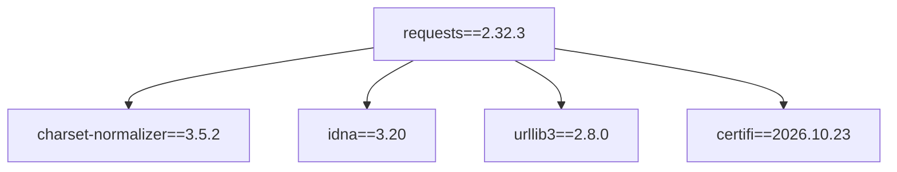
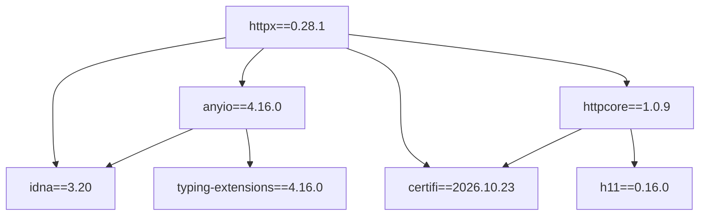
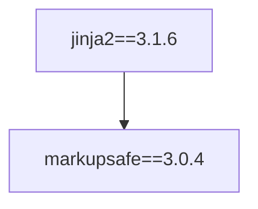

# Проверка практической работы № 2

## Этап 4. Порядок установки

### Тестовый репозиторий

| Команда | Результат |
| --- | --- |
| `python -m src examples/test-cycle.json --order` | D, B, E, C, A. Программа сообщает о цикле D → B. |
| `python -m src examples/test-filter.json --order` | D, E, C, A. После исключения B цикла нет. |

### Сравнение с pip

Проверка выполнена на Windows, Python 3.12.14, pip 26.2.2. Использован
чистый каталог для установки, чтобы ранее установленные модули не
повлияли на вывод.

```powershell
python -m src examples/requests.json --order
python -m pip install --ignore-installed --only-binary=:all: --target out/pip-requests requests==2.32.3
```

| Инструмент | Порядок |
| --- | --- |
| CLI | charset-normalizer, idna, urllib3, certifi, requests |
| pip, строка `Installing collected packages` | urllib3, idna, charset-normalizer, certifi, requests |

Все четыре зависимости идут перед `requests`. Между этими четырьмя
пакетами нет рёбер, поэтому допустимы оба порядка. CLI обходит требования
в порядке записи в метаданных. pip устанавливает зависимости перед
зависящими пакетами и не гарантирует порядок независимых пакетов.
[Порядок установки в документации pip](https://pip.pypa.io/en/stable/cli/pip_install/#installation-order)

## Этап 5. Визуализация

```powershell
python -m src examples/requests.json
python -m src examples/httpx.json
python -m src examples/jinja2.json
```

Команды создают три PNG и три исходника Mermaid в `out/`.
Все три конфигурации также выводят ASCII-дерево.

### requests 2.32.3



### httpx 0.28.1



### Jinja2 3.1.6



### Сравнение с установленными пакетами

Для каждого корня пакеты установлены в отдельный чистый каталог.
Команда `pip inspect` выводит метаданные и активное окружение.
Для сравнения использованы записи `requires_dist`, активные в этом
окружении, и версии всех установленных пакетов.

```powershell
python -m pip install --ignore-installed --only-binary=:all: --target out/pip-httpx httpx==0.28.1
python -m pip install --ignore-installed --only-binary=:all: --target out/pip-jinja2 Jinja2==3.1.6
python -m pip inspect --path out/pip-requests
python -m pip inspect --path out/pip-httpx
python -m pip inspect --path out/pip-jinja2
```

| Пакет | Узлы с корнем | Рёбра | Совпадение с pip |
| --- | ---: | ---: | --- |
| requests | 5 | 4 | Совпали все имена, версии и рёбра. |
| httpx | 7 | 8 | Совпали все имена, версии и рёбра. |
| Jinja2 | 2 | 1 | Совпали все имена, версии и рёбра. |

В выводе pip встречаются `Jinja2`, `MarkupSafe` и `typing_extensions`,
а на графах имена приведены к канонической форме PEP 503. Состав
транзитивных зависимостей может измениться со временем по мере
публикации новых выпусков. [Документация pip inspect](https://pip.pypa.io/en/stable/cli/pip_inspect/)
